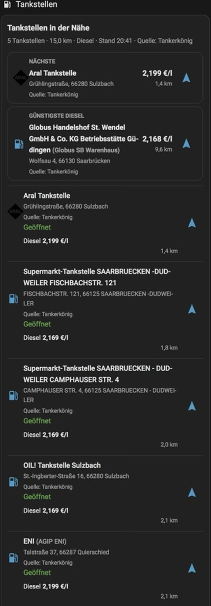

# Mobile Fuel Stations

[🇩🇪 Deutsch](README.md) | 🇬🇧 **English**

<p align="center"></p>

<p align="center">
  <a href="https://github.com/balronu/ha-mobile-fuel-stations/releases/tag/v0.7.3"></a>
  <a href="https://www.home-assistant.io/integrations/"></a>
  <a href="https://www.hacs.xyz/docs/faq/custom_repositories/"></a>
  <a href="LICENSE"></a>
  <a href="https://github.com/balronu/ha-mobile-fuel-stations/actions/workflows/tests.yml"></a>
</p>

**Dynamic GPS-based fuel station discovery and price comparison for Home
Assistant** – multi-provider, route-aware, and with navigation directly from
the Lovelace card. The integration follows the position of a vehicle,
motorhome, or other tracker and exposes stations, fuel prices, distance,
opening status, and destination navigation.

### At a glance

- **GPS along the journey:** Find stations from the current position of any
  entity that provides latitude and longitude.
- **Multiple data sources:** Tankerkönig, Petromap, and Nakordoni with
  capability-aware provider selection.
- **Fuel prices:** E5, E10, diesel, LPG, and HVO100 with distance or price
  sorting.
- **Built for Lovelace:** Responsive card, recognition of many brand spellings,
  60 local station-brand logos, and direct navigation to the selected
  destination.

### Preview

<p align="center"></p>

### Quick start

1. Install the repository through
   [HACS](https://github.com/balronu/ha-mobile-fuel-stations), or add it as a
   custom repository.
2. Set up the integration under **Settings → Devices & services**.
3. Select an entity with `latitude` and `longitude`, fuel types, search radius,
   and provider mode.
4. Continue with the complete [HACS installation guide](README.en.md#installation-with-hacs).

> This README is the complete English guide. The full German primary guide is
> available in [README.md](README.md). The compatibility copy remains
> available in [README.de.md](README.de.md).

## Contents

- [Versions and features](README.en.md#versions-and-features)
- [Installation with HACS](README.en.md#installation-with-hacs)
- [Setup and configuration](README.en.md#setup-and-configuration)
- [Providers, countries, and fuels](README.en.md#providers-countries-and-fuels)
- [API keys](README.en.md#api-keys)
- [GPS, polling, and startup recovery](README.en.md#gps-polling-and-startup-recovery)
- [Lovelace card and brand logos](README.en.md#lovelace-card-and-brand-logos)
- [Prices, sorting, and navigation](README.en.md#prices-sorting-and-navigation)
- [Updates and migration](README.en.md#updates-and-migration)
- [Privacy and limitations](README.en.md#privacy-and-limitations)
- [Troubleshooting and diagnostics](README.en.md#troubleshooting-and-diagnostics)
- [Development and tests](README.en.md#development-and-tests)
- [Release archive](README.en.md#release-archive)

## Versions and features

| Channel | Version | Meaning |
| --- | --- | --- |
| Stable | `v0.7.3` | Current stable release |
| Previous stable | `v0.7.2` | Available rollback version |
| Frontend component | `v0.7.3` | Independently versioned Lovelace component |

`v0.7.3` is the current stable release. It bundles Tankerkönig, Petromap, and
Nakordoni with automatic provider selection, country- and market-aware
fallback, quota/Trip Pass diagnostics, OAuth2-PKCE, and manual API keys. The
60 local PNG logos come from the supplied ZIP, and the resource is registered
automatically with cache key `v=0.7.3`. Nakordoni OAuth was checked statically
but has not been confirmed through a live callback. Source, missing per-image
license, and residual trademark risks are documented in
[BRAND_LOGOS.md](BRAND_LOGOS.md); this is not a trademark license or endorsement.

v0.7.1 also improved discovery of integration-owned overview sensors in the
visual Lovelace editor. Temporarily `unavailable` sensors are offered for
selection as well. Multiple vehicles or Config Entries remain separate: select
the vehicle's own overview entity for each card. Existing YAML cards with a
direct entity ID remain compatible.

v0.7.2 includes stations with unknown opening status in the “NEAREST” and
“CHEAPEST” highlights. Explicitly closed stations remain excluded, and an
unknown status is never rendered as “Open”. Selection is provider-neutral and
deterministic.

v0.7.3 normalizes Nakordoni E10 prices for the cheapest highlight even for
single-fuel requests. Structured and formatted provider addresses are kept
when supplied; missing addresses remain empty. Explicitly stale prices are not
selected as the current cheapest result.

Features include nearby stations based on a tracker entity, E5/E10/diesel/LPG
and HVO100 selection, multi-fuel station sensors, distance and fuel-price
sorting, automatic provider selection, startup recovery, regular coordinator
polling, movement refreshes, navigation, a responsive Lovelace card, persisted
context-checked station cache, cooldown recovery, and optional adaptive GPS
refresh.

## Installation with HACS

1. Open **HACS → Integrations**.
2. Search for **Mobile Fuel Stations**. If it is not listed, add
   `https://github.com/balronu/ha-mobile-fuel-stations` under **Custom
   repositories** with type **Integration**.
3. Install the integration.
4. Fully restart Home Assistant.
5. Open **Settings → Devices & services → Add integration** and select
   **Mobile Fuel Stations**.

`v0.7.3` is the current stable HACS version; `v0.7.2` remains available as the
previous stable rollback.

The Lovelace card is supplied and registered by the integration. The
independently versioned frontend resource remains:

```text
/mobile_fuel_stations/mobile-fuel-stations-card.js?v=0.7.3
```

For technical resource-loading details, see
[docs/RESOURCE_LOADING.md](docs/RESOURCE_LOADING.md).

## Setup and configuration

The configuration flow selects a position entity with `latitude` and
`longitude`, radius, station slots (1–10), one or more fuel types, provider
mode, sorting, polling interval, movement threshold/cooldown, and navigation
service. General options and credentials are stored separately. Empty
credential fields keep existing keys; keys are never shown in full.

Adaptive updates are disabled by default and can be enabled through the
Options flow. With valid, current GPS speed, target intervals are 15 minutes
while stationary, 5 minutes up to 30 km/h, 2 minutes above 30 to 70 km/h, and
1 minute above 70 km/h. Provider cooldowns, rate limits, and `Retry-After`
always take precedence; no artificial GPS positions are generated.

## Providers, countries, and fuels

The following matrix reflects capabilities verified in the code and tests.
External contracts, quotas, and account permissions can reduce availability.

| Provider | Access | Verified coverage and fuels |
| --- | --- | --- |
| [Tankerkönig](https://onboarding.tankerkoenig.de/) | API key | Germany; diesel, E5, E10; maximum API radius 25 km |
| [Petromap](https://developer.petromap.eu/) | API key and possibly approval | Station prices in Germany and Austria for diesel, E5, and LPG; further countries/data depend on Petromap |
| [Nakordoni](https://nakordoni.eu/en/developers) | OAuth2-PKCE or API key, market/access approval | Diesel, E5, E10, and LPG; DE, AT, PL, CZ, SK, HU, SI, HR, IT, FR, BE, NL, and LU require confirmed market permission |

Selectable fuel keys are `e5`, `e10`, `diesel`, `lpg`, and `hvo100`. A provider
is used only when its capability and response support the requested fuel.
HVO100 is not silently converted to diesel. Prices are shown only where a
provider/country capability is verified. In automatic mode only enabled,
configured, and market-authorized providers are considered. Germany prefers
Tankerkönig then Nakordoni; Austria prefers Petromap then Nakordoni; other
supported countries prefer Nakordoni then a suitable Petromap fallback. The
`markets_approved`, `markets_granted`, `markets_allowed`, and
`markets_available` fields remain distinct; missing market metadata never
grants Nakordoni Auto eligibility. E10 may use an explicitly supported E5
substitution; this does not apply to diesel, LPG, or HVO100.

## API keys

Each enabled provider requires its own access. Follow the provider's
registration, approval, quota, cost, privacy, and terms requirements:

- [Tankerkönig onboarding](https://onboarding.tankerkoenig.de/)
- [Petromap developer portal](https://developer.petromap.eu/)
- [Nakordoni developer portal](https://nakordoni.eu/en/developers)

Enter keys under **Settings → Devices & services → Mobile Fuel Stations →
Configure → Manage credentials**. A stored key is not proof of a successful
live check. The options flow does not perform unnecessary network requests.
Credentials are never written to Git, logs, or diagnostics.

### Nakordoni OAuth2-PKCE

The integration provides the preferred automatic Nakordoni sign-in using Home
Assistant's OAuth2 Authorization Code flow with PKCE S256. The registered
redirect is exactly
`https://my.home-assistant.io/redirect/oauth`; no client secret is used.

The manual API-key method remains available. Existing API-key entries are not
migrated, deleted, or forced through OAuth. HVO100 remains disabled for
Nakordoni until the documented `hvo` field is confirmed to mean HVO100.
OAuth tokens are
stored by Home Assistant's OAuth2 config-entry machinery and are excluded from
diagnostics. OAuth is only complete when Nakordoni returns the token fields
required by Home Assistant, including `expires_in`; undocumented scopes or
refresh parameters are not assumed.

## GPS, polling, and startup recovery

The configured entity must provide valid coordinates. After startup, the
integration creates its entities and performs the normal coordinator refresh. If
GPS is unavailable, startup recovery checks again at approximately 3, 10, and
30 seconds, then approximately every 60 seconds until GPS becomes available or
the integration is unloaded.

A matching GPS event can trigger the next attempt immediately. Timed checks
remain active so missed `state_changed` events and attribute-only changes do
not force users to wait for the next 15-minute cycle. All recovery triggers go
through one deduplicated path. Recovery and regular polling never issue
parallel provider requests.

Transient provider failures use bounded exponential backoff and jitter.
`Retry-After` and detected rate limits take precedence. Permanent
authentication or configuration failures are diagnosed without an aggressive
retry loop. Valid cached data is retained and marked stale during transient
failures. Successful recovery ends the recovery loop; normal polling and the
movement refresh remain active. Timers, tasks, and listeners are cleaned up on
unload/reload.

The last validated station result is persisted in the existing Home Assistant
Store. A matching reload restores it immediately as `data_stale=true`; cache
entries with a different query context, location, or invalid data are rejected.
After cooldown expiry, at most one deduplicated provider refresh is scheduled.

## Lovelace card and brand logos

```yaml
type: custom:mobile-fuel-stations-card
entity: sensor.mobile_fuel_stations_device_tracker_wohnmobil_zoe_nearby_stations
navigation: true
show_brand_logos: true
```

With multiple vehicles, each config entry has its own overview sensor. The
visual editor also lists temporarily unavailable Mobile Fuel Stations sensors;
manually configured entity IDs remain supported.

Stable v0.7.2 recognizes all 60 bundled local PNG assets, including:
Aral (`aral.png`), Shell (`shell.png`), JET (`jet.png`),
Total/TotalEnergies (`total.png`), ORLEN/ORLEN Express (`orlen.png`),
and OMV (`omv.png`). Matching normalizes
case, Unicode accents, whitespace, and punctuation. If `brand` is missing or
does not match, the station name is checked as a fallback. Unknown, empty, or
unloadable logos use the generic fuel-pump symbol. The reported names
`Eni (Agip Eni)` and `OIL! Tankstelle Sulzbach` use explicit aliases for
`agip-eni.png` and `oil.png`; broad uncertain substring matches remain
excluded. Set
`show_brand_logos: false` to disable logos. Sources and checksums are listed in
[docs/BRAND_LOGOS.md](docs/BRAND_LOGOS.md).

Alias matching recognizes substantially more brand names and provider
spellings. This does not mean that an image is bundled for every recognized
brand: the 60 normalized archive PNGs listed in the inventory are included.
The excluded generic files, unknown brands, and failed
assets use the neutral fuel-pump symbol while the brand name remains readable.
The complete reference inventory is documented in
[docs/BRAND_LOGO_INVENTORY.md](docs/BRAND_LOGO_INVENTORY.md).

Local user-owned logos can still be used through the supported `logo_path`
configuration from `/local/...` or `/hacsfiles/...`. External logo URLs are
neither required nor allowed. Brands are shown solely to identify actual fuel
stations; the project has no official relationship with the brand owners.
Trademark rights and concrete image-redistribution rights are documented
separately and are not granted as a blanket permission.

The card shows station name, address, distance, opening status, price age,
available prices, E5/E10 substitution hints, and navigation. Local SVGs may be
placed in Home Assistant's local `www` directory and referenced through the
corresponding `/local/...` path; unsafe paths and external URLs are rejected.
Image errors fall back to the generic symbol.

## Prices, sorting, and navigation

Stations are sorted by distance by default. Price sorting requires one explicit
fuel type; stations without a valid price appear last. Different fuel types
are never mixed into one ranking, and a missing price is not replaced with a
different fuel. Depending on configuration, navigation can use Apple Maps,
Google Maps, Waze, or automatic selection.

## Updates and migration

Create a Home Assistant backup before updating. Update through HACS and fully
restart Home Assistant. Existing config entries, credentials, station sensors,
and compatible dashboard configurations are retained. Check the versioned card
resource and browser cache after a major update. `v0.6.1` remains available as
the previous stable rollback; historical releases remain in the GitHub
archive.

## Privacy and limitations

Depending on the selected provider, coordinates, radius, and fuel selection
may be sent to external APIs. Review each provider's privacy policy and terms.
The integration does not send a device ID to Nakordoni, does not log complete
API keys, and does not expose exact private coordinates in diagnostics. Keep
the visible **Data by nakordoni.eu** attribution when using Nakordoni.

Provider coverage, prices, opening hours, quotas, and permissions can change.
Nakordoni market coverage and HVO100 prices are not universally guaranteed.

## Administrator Nakordoni diagnostics

For a targeted, non-production test, the integration registers the protected
Home Assistant service `mobile_fuel_stations.probe_nakordoni`. Only an
authenticated administrator may call it, and it uses the Nakordoni credential
already stored for the selected config entry. One call performs exactly one
request and never retries automatically; concurrent probes for the same entry
are rejected.

The request requires `entry_id`, `latitude`, `longitude`, `radius_km` (0 to
25), and one verified fuel key: `diesel`, `e5`, `e10`, or `lpg`. The response
contains only status, quota, latency, station/price counts, price age, and safe
coverage hints. It never returns API keys, tokens, station names, raw payloads,
or complete coordinates.

The probe bypasses the coordinator and automatic provider mode, leaving the
station cache, sensor state, and config entry unchanged. OAuth2 entries use
Home Assistant's existing OAuth2 session. This function is for diagnostics only
and must not be used as a public data feed.

## Troubleshooting and diagnostics

- **Overview sensor is missing from the card editor:** Since v0.7.1,
  integration-owned overview sensors that are temporarily unavailable are also
  discovered and offered by the visual editor. Existing YAML cards may still
  specify their entity ID directly.
- **Overview sensor is `unavailable`:** Being selectable in the editor only
  confirms entity discovery; it does not confirm a successful data request.
  Check location, provider configuration, API key, country/market permission,
  and the available diagnostics.
- **Highlight missing despite station data:** Since v0.7.2, stations with an
  unknown opening status are eligible for “NEAREST” and “CHEAPEST”. Explicitly
  closed stations remain excluded; unknown status is not shown as “Open”.
- **Known Opel Grandland E10 case:** In one configuration, Tankerkönig
  produced `ProviderResponseError` and entered a provider cooldown. Removing
  Tankerkönig and selecting Nakordoni made the request work. This does not
  establish the exact Tankerkönig root cause or prove that general fallback
  behavior is fixed.
- **No stations:** check the entity, valid coordinates, radius, provider mode,
  and credential status.
- **GPS unavailable at startup:** inspect recovery status, attempt count, and
  next retry; a valid GPS event accelerates recovery.
- **Missing price:** no valid price was returned for that station and fuel.
- **Provider error:** fix authentication/configuration errors; transient
  errors retain cached data and mark it stale. A successful empty response
  means zero stations, while `None` is reserved for missing GPS or a failure
  before the first usable result.
- **Missing logo:** check `brand`, station name, `show_brand_logos`, resource
  version, and browser cache.

Diagnostics include recovery status, attempt count, last trigger, next retry,
GPS event type/time, in-flight status, and error classification, but no
coordinates, tokens, or complete keys.

## Development and tests

```bash
python -m pytest
cd frontend && npm ci && npm test -- --run && npm run typecheck && npm run build
python -m compileall custom_components tests
```

CI additionally checks Home Assistant/Hassfest compatibility, bundle and diff
consistency, Markdown/version consistency, and secret scanning. Provider and
recovery tests use mocks and fixtures rather than unverified live credentials.

## Release archive

Historical release notes are preserved in the
[GitHub release archive](https://github.com/balronu/ha-mobile-fuel-stations/tree/main/docs/releases/), including the current
[`v0.7.3 release notes`](docs/releases/RELEASE_NOTES_v0.7.3.md).
See also [CONTRIBUTING.md](CONTRIBUTING.md),
[docs/BRAND_LOGOS.md](docs/BRAND_LOGOS.md), and the
[GitHub releases](https://github.com/balronu/ha-mobile-fuel-stations/releases).
